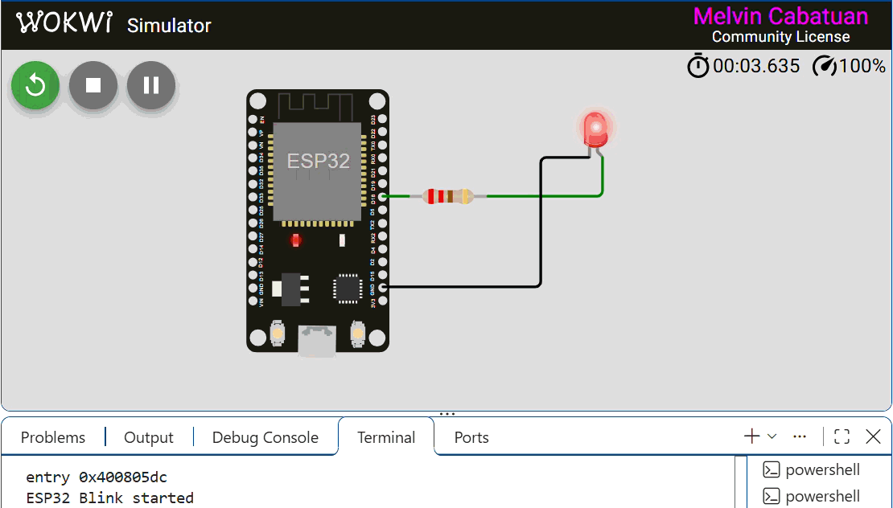
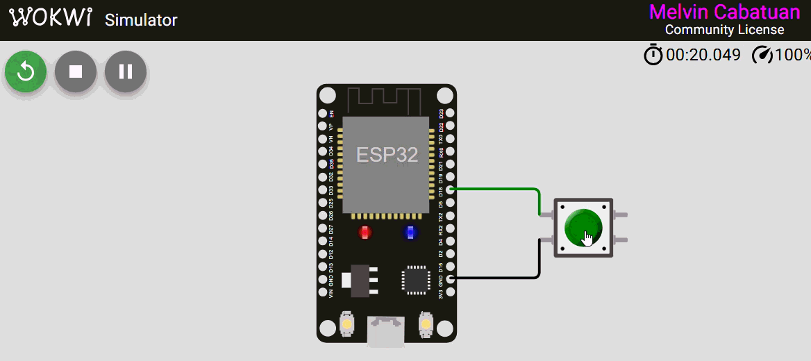
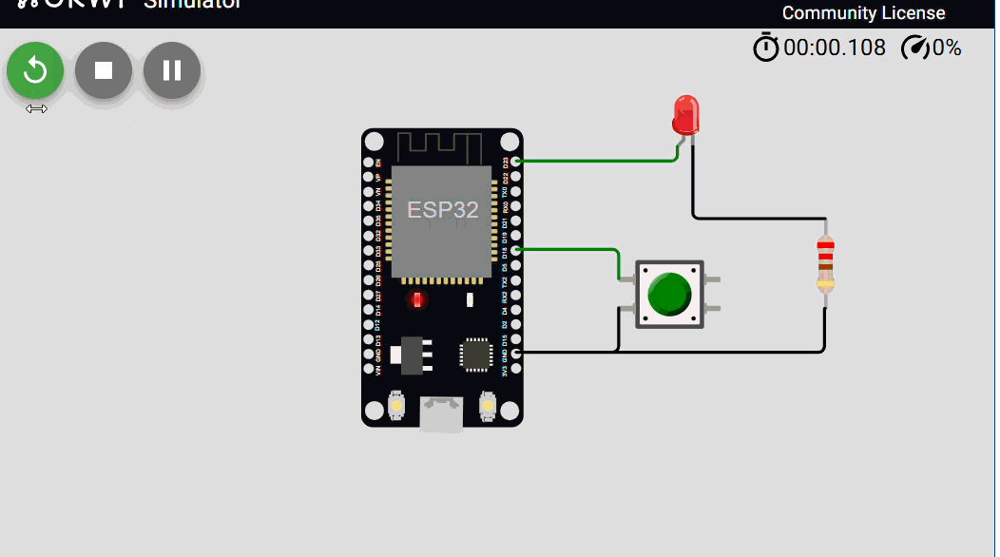
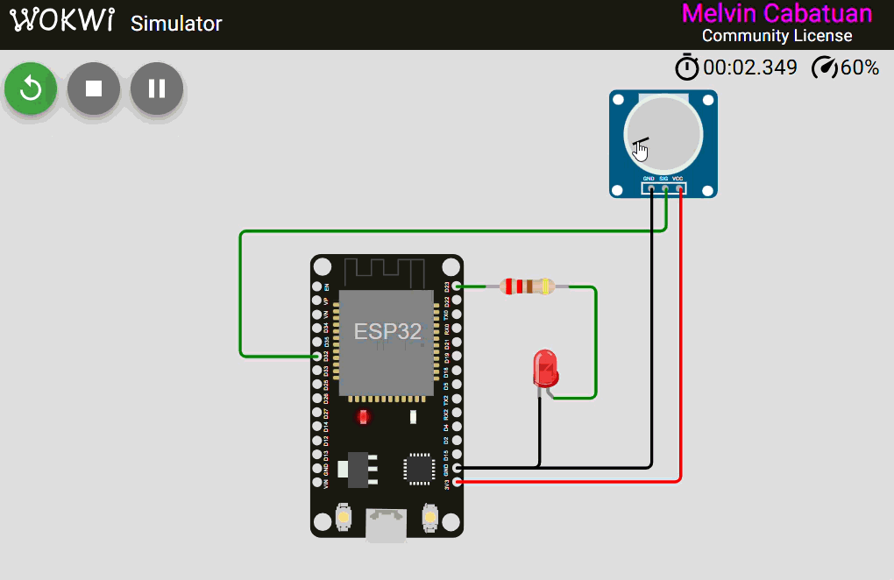

# Embedded System Projects

## GPIO as Output
- [esp32-blink](https://github.com/melvincabatuan/Projects/tree/main/esp32-blink) (Hello World Blinking LED)

- [esp32-running-lights-active-high](https://github.com/melvincabatuan/Projects/tree/main/esp32-running-lights-active-high) (Running Lights with Common Beginner Pins - Active HIGH)

- [esp32-running-lights-active-low](https://github.com/melvincabatuan/Projects/tree/main/esp32-running-lights-active-low) (Running Lights with Common Beginner Pins - Active LOW)

## GPIO as Input
- [esp32-simple-pushbutton-internal-led](https://github.com/melvincabatuan/Projects/tree/main/esp32-simple-pushbutton-internal-led) (Simple Pushbutton Circuit with INPUT_PULLUP)

- [esp32-simple-pushbutton-led](https://github.com/melvincabatuan/Projects/tree/main/esp32-simple-pushbutton-led) (Simple Pushbutton Circuit with INPUT_PULLUP)

- [esp32-toggle-pushbutton-led](https://github.com/melvincabatuan/Projects/tree/main/esp32-toggle-pushbutton-led) (Toggle Pushbutton Circuit with INPUT_PULLUP)

## Analog Input
- [esp32-potentiometer-input](https://github.com/melvincabatuan/Projects/tree/main/esp32-potentiometer-input) (ESP32 PWM)

- [esp32-potentiometer-ledt](https://github.com/melvincabatuan/Projects/tree/main/esp32-potentiometer-led) (ESP32 PWM controls LED Blinking)

## PWM Output esp32-pwm-output-led
- [esp32-pwm-led](https://github.com/melvincabatuan/Projects/tree/main/esp32-pwm-led) (ESP32 PWM)
