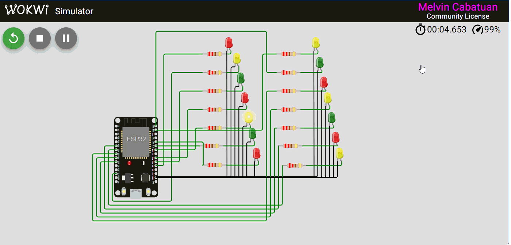

# Embedded System Projects

- [esp32-blink](https://github.com/melvincabatuan/Projects/tree/main/esp32-blink) (Hello World Blinking LED)

- [esp32-running-lights-active-high](https://github.com/melvincabatuan/Projects/tree/main/esp32-running-lights-active-high) (Running Lights with Common Beginner Pins - Active HIGH)

- [esp32-running-lights-active-low](https://github.com/melvincabatuan/Projects/tree/main/esp32-running-lights-active-low) (Running Lights with Common Beginner Pins - Active LOW)

